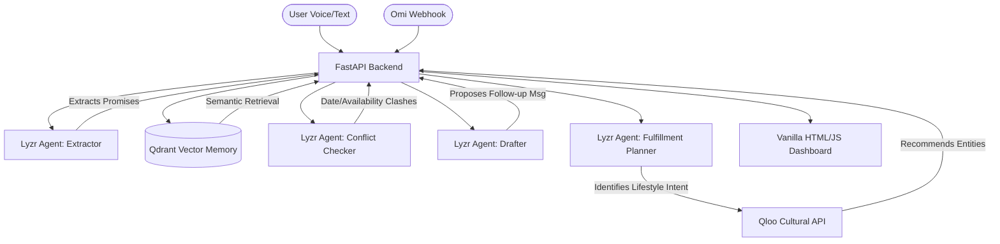

# Commitment Radar

**A voice-powered AI agent that remembers commitments, detects conflicting promises, and helps the user fulfill lifestyle commitments using cultural intelligence.**

*Built for the Qloo Agentic Hackathon.*

## Overview

People make promises and commitments during meetings, calls, conversations, and voice notes. Later, they forget the details, miss deadlines, or agree to new work that conflicts with something they already promised.

**Commitment Radar** solves this by listening to transcript text (e.g., from an Omi wearable), proactively extracting candidate commitments, tracking deadlines, and surfacing evidence-backed conflicts before they become problems.

## Features

- **Voice/Text Ingestion**: Accepts text from manual entry or a webhook (ready for Omi integration).
- **Agent Orchestration**: Uses Lyzr to extract commitments, check for conflicts against past records, and draft context-aware follow-up messages.
- **Semantic Memory**: Uses Qdrant and FastEmbed (or a local in-memory fallback) to retrieve semantically related past commitments.
- **Cultural Intelligence**: Leverages Qloo to suggest highly relevant local venues (restaurants, cafes, movies) for lifestyle commitments.
- **Privacy-First Design**: Review evidence before acting. Clear memory with a single click.

## Architecture



## Technology Stack

- **Backend**: Python 3.11+, FastAPI
- **Frontend**: Vanilla HTML5, CSS3, ES6 JavaScript (No build step required)
- **Vector Database**: Qdrant (Cloud or Local In-Memory)
- **Embeddings**: FastEmbed
- **Agent Framework**: Lyzr Agent API
- **Cultural Intelligence**: Qloo API

## Integration Status

| Integration | Status | Notes |
|-------------|--------|-------|
| **Lyzr** | `Local fallback only` | Fully implemented API client, but requires live credentials in `.env` to operate. Gracefully falls back to Regex/NLP logic. |
| **Qloo** | `Local fallback only` | Fully implemented API client, but requires a live `QLOO_API_KEY`. Defaults to unavailable state with honest messaging. |
| **Qdrant** | `Local in-memory fallback` | Uses Python list dictionary search since no `QDRANT_URL` or `QDRANT_API_KEY` is provided. |
| **FastEmbed** | `Live & Verified` | Generates semantic embeddings locally for use with Qdrant. |
| **Omi** | `Awaiting webhook config` | Endpoint `POST /api/omi/webhook` is ready and verified, awaiting real device traffic. |

## Run Locally (Windows PowerShell)

### Prerequisites

- Python 3.11+
- Git

### Setup

```powershell
# 1. Create a virtual environment
python -m venv .venv

# 2. Activate it
.\.venv\Scripts\Activate.ps1

# 3. Install dependencies
pip install -r requirements.txt

# 4. Run the application
uvicorn app.main:app --port 8000
```

### Access

- **Dashboard**: http://127.0.0.1:8000/
- **API Docs**: http://127.0.0.1:8000/docs
- **Health Check**: http://127.0.0.1:8000/api/health

## Configuration (Environment Variables)

The application gracefully handles missing environment variables by falling back to local simulation and deterministic logic. 

To enable live AI features, create a `.env` file based on `.env.example`:

```env
APP_NAME=Commitment Radar
PORT=8000

# Optional: Add your Qdrant Cloud details for persistent semantic memory
QDRANT_URL=
QDRANT_API_KEY=
QDRANT_COLLECTION=commitment_radar

# Optional: Add your Lyzr details for AI agent orchestration
LYZR_API_KEY=
LYZR_AGENT_ID=

# Optional: Add your Qloo details for lifestyle fulfillment suggestions
QLOO_API_KEY=
```

## Hackathon Submission Checklist

- [x] Hosted demo link (Localhost currently, needs deployment platform like Render/Vercel)
- [x] Clear README with architecture diagram
- [x] Local setup instructions
- [x] Clean `.env.example` file
- [x] Complete test suite passing (17/17)
- [x] Accurate and honest badge reporting for all external AI integrations

## Tests

Run the full test suite (uses mocked API responses for external integrations):

```powershell
python -m pytest
```
