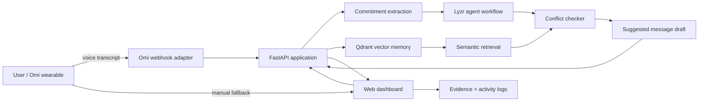

# Architecture

## Request lifecycle
1. Omi webhook or manual dashboard sends transcript.
2. Backend validates and logs intake.
3. Qdrant retrieves similar prior records.
4. Extractor identifies commitment candidates and metadata.
5. Conflict logic compares new candidates with retrieved history.
6. Drafting stage proposes a message; it never sends automatically.
7. UI displays commitments, quoted evidence, integration status, and workflow logs.

## Responsibilities
- **Omi:** voice capture and transcript delivery.
- **FastAPI:** validation, orchestration, API, static frontend.
- **Qdrant:** vector retrieval with payload metadata such as owner, recipient, deadline, source, and record type.
- **Lyzr:** agent reasoning/orchestration. Configure and prove the real workflow in your account.
- **Conflict checker:** transparent baseline rules; alerts remain “possible conflicts.”
- **Frontend:** capture, recent commitments, conflicts, evidence, and observability.

## Before production
Use a real embedding model, add user authentication and per-user vector filters, verify Omi webhook signatures using the actual supported mechanism, add persistent application storage, and configure rate limits/error monitoring.
